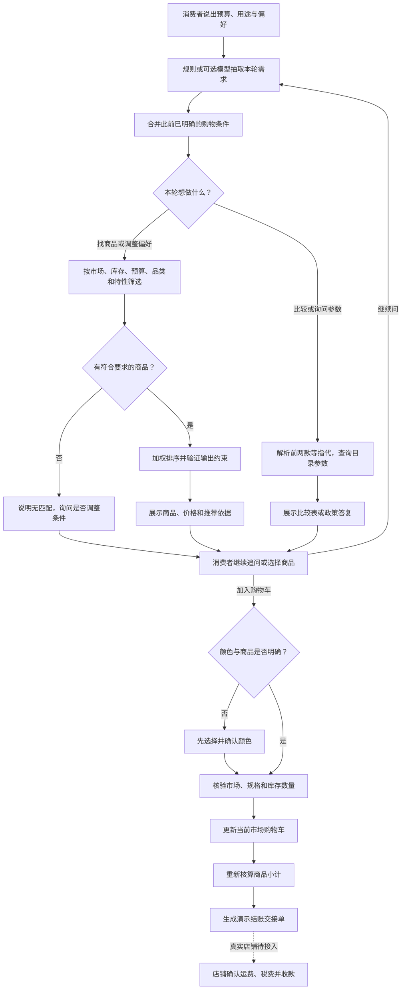

# ShopMate 详细工作流 v2

## 需求与记忆
新预算覆盖旧预算，未提供的预算继续继承；更换主品类或耳机与音箱子品类时移除不兼容特性。“不需要降噪”可以取消旧特性。切换市场重置偏好，旧消息仍显示原市场。

## 推荐
硬约束：市场、库存、预算、品类、子品类和明确特性。无候选就澄清，不放宽条件。匹配分：需求38%、预算22%、库存15%、配送15%、评分10%。输出再次验证来源、价格、预算、市场、库存和特性，不通过则阻断展示。

## 比较与追问
“前两款”“第一款”等从当前对话的上一轮商品列表解析；具名商品使用目录匹配。比较读取价格、续航、重量、库存与政策，缺失字段显示未提供。不能解析商品时先澄清。

## 规格和购物车
颜色缺失则要求选择；明确颜色才加入。购物车键为商品+颜色+市场，同商品各颜色总数量不能超过库存。移除和数量变更在当前浏览器保存。

## 结账交接
重新从目录计算单价和小计，校验颜色、市场、数量和库存。未知税费与运费不编造。当前仅导出交接JSON，不创建真实订单、不收款；真实店铺接入后才能跳转托管结账。

## 可选模型与异常
默认规则。配置本地模型后仅辅助需求抽取，明确预算和售后规则仍优先；供应商错误、超时或不合法JSON回退规则。模型不能直接生成商品价格、库存、规格或订单事实。
